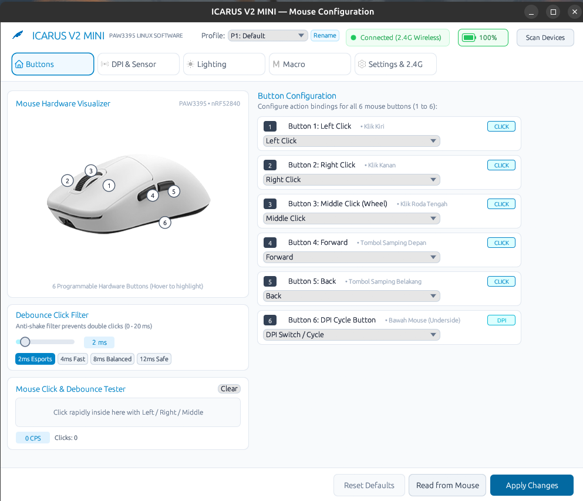
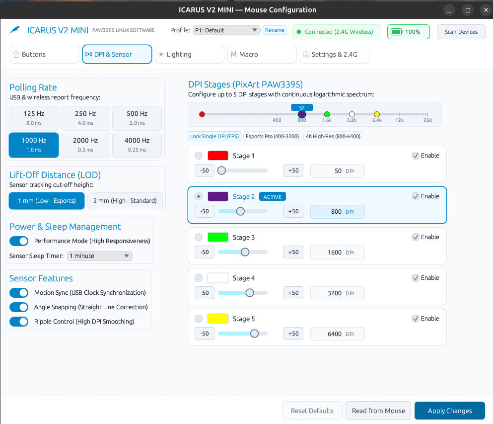
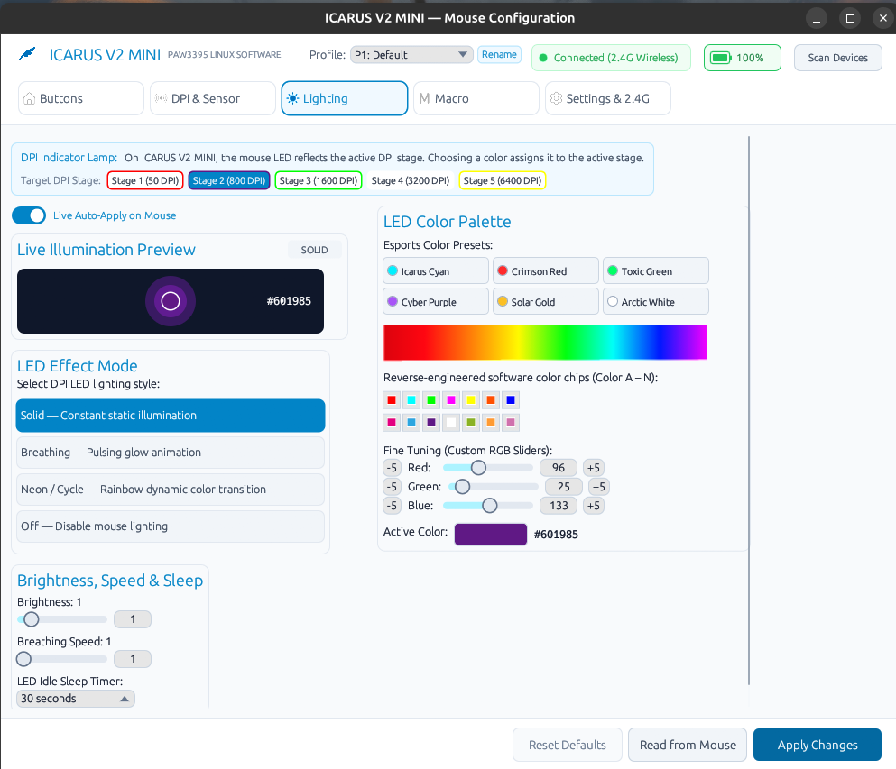
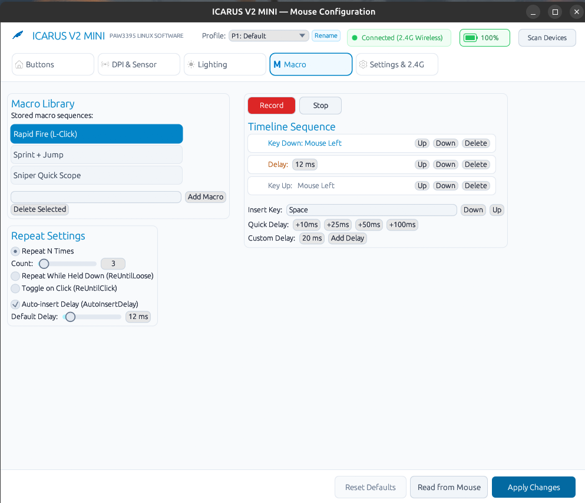
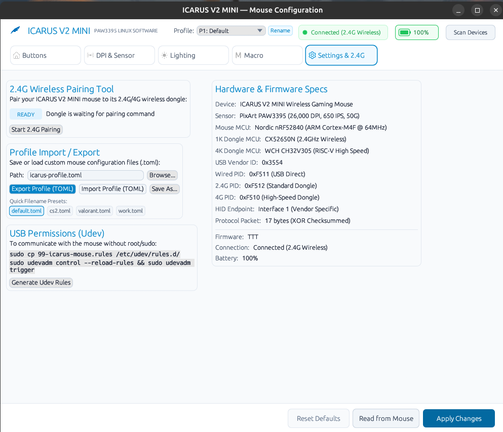
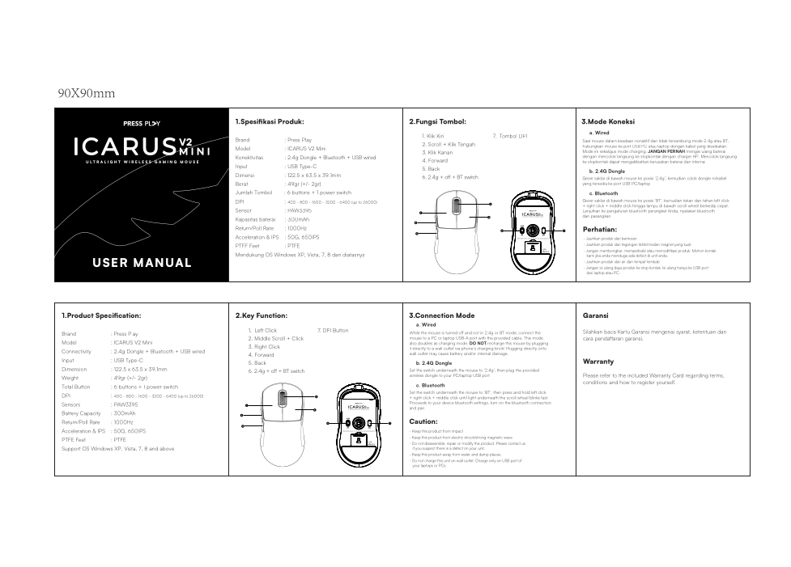

# ICARUS V2 MINI — Linux Driver & Native GUI

[](https://www.rust-lang.org/)
[](LICENSE)
[-green.svg)]()
[]()
[]()
[](https://github.com/ayrazarya/icarus-v2mini-rea/releases)

A native, lightweight, and high-performance Linux driver, CLI configuration utility, background daemon, and desktop GUI for the **ICARUS V2 MINI** ultralight wireless gaming mouse by **[Press Play](https://pressplayid.com/)**, written from scratch in pure, memory-safe Rust (`unsafe_code = "forbid"`).

Reverse-engineered directly from the official Windows vendor software (`ICARUS V2 MINI_v1.0.1.2_setup.exe` & `HIDUsb.dll`). It communicates directly with the mouse and 2.4G/4K wireless receivers via raw Linux HID endpoints (`hidapi`) without Wine, Windows VMs, Electron, or heavy runtime dependencies.

> **Companion Project Documentation:**
> - [**Architecture & Code Structure (`docs/ARCHITECTURE.md`)**](docs/ARCHITECTURE.md) — Deep dive into modular DDD layers, data flows, and runtime performance optimizations.
> - [**USB HID Protocol & EEPROM Specification (`docs/PROTOCOL.md`)**](docs/PROTOCOL.md) — Complete 17-byte packet format, opcodes, checksums, and PAW3395 register maps.
> - [**Coding Standards & Contributing Guide (`CONTRIBUTING.md`)**](CONTRIBUTING.md) — How to code, extend hardware commands/GUI tabs, and pass QA verification.
> - [**Examples & Diagnostic Tools (`examples/README.md`)**](examples/README.md) — Sample `.toml` profiles and low-level hardware DPI register probe.
> - [**Changelog (`CHANGELOG.md`)**](CHANGELOG.md) — Full version history and release notes.

---

## Graphical User Interface (UI Previews)

The desktop application is built with `egui` and `eframe`, providing hardware-accelerated 60+ FPS rendering under both Wayland and X11 with minimal RAM consumption (< 30 MB).

### Tab 1: Button Remapping & Debounce Tester
Interactive 3D mouse visualizer with calibrated button callouts, action binding editor, hardware debounce slider (0–20 ms in 2 ms steps), and a live click tester with CPS counter, interval delta, and double-click detector.

<p align="center">
  
</p>

### Tab 2: DPI, Sensor Calibration & Spectrum Bar
6-stage DPI adjustment with clickable milestone ticks, free-text custom DPI input (50–26,000 DPI in 50 DPI steps), bijective 10-bit Separate X/Y DPI calibration, Single DPI Lock (competitive FPS mode), quick esports presets, and sensor tuning (LOD, Polling Rate, Angle Snapping, Motion Sync, Ripple Control).

<p align="center">
  
</p>

### Tab 3: Lighting & Live Real-Time Auto-Apply
RGB lighting modes (Solid, Breathing, Neon, Off), 10-level brightness and speed sliders, sleep idle timeout, 14 reverse-engineered ColorBoard swatches (A–N), esports color presets, custom RGB sliders, 4K wireless dongle RGB control, and throttled (`120ms`) live instant preview that synchronizes with the physical mouse in real time.

<p align="center">
  
</p>

### Tab 4: Macro Recording & Timeline Sequencer
Live macro keystroke & mouse-click recorder and interactive visual timeline sequencer with reorderable events, delay adjustments (`1..=65535` ms), loop modes, 64-event hardware slot protection, and direct EEPROM flashing (`0x0300` base).

<p align="center">
  
</p>

### Tab 5: Settings, Bilingual Language Selector (EN/ID), 2.4G Dongle Pairing & Profile Management
Full bilingual support (English and Bahasa Indonesia) with zero language mixing or overlapping strings (switchable instantly via top header `🌐 EN` / `🌐 ID` or Settings tab), 2.4G wireless pairing tool, Long-Range RF boost, ISP firmware flasher, per-game Auto-Profile rules, native Linux GTK file selection dialog (`zenity`) for custom profile import/export, and automatic udev rule generation.

<p align="center">
  
</p>

---

## Hardware Documentation & Official Resources

### Quick Start & Hardware Layout Guide

Below is the hardware control overview and quick start reference from the official user manual:

<p align="center">
  
</p>

### Official Manual & Vendor Driver Downloads

| Resource | Description | Link |
|---|---|---|
| **Official User Manual (PDF)** | Complete manufacturer manual, connection instructions, and hardware specs | [Google Drive View](https://drive.google.com/file/d/1kOBQNL2h7rpvUaaqBG93QY5Y8SZC2IE1/view) |
| **Official Windows Driver (Setup)** | Original OEM software installer archive (`ICARUS V2 MINI_v1.0.1.2_setup.exe`) | [Google Drive Download](https://drive.google.com/file/d/17_9BynDQM6Is3RK7znR3YGmAVbIj7niy/view) |
| **Press Play Software & Manuals Portal** | Official manufacturer driver, software, and firmware download repository | [Press Play Software & Manuals](https://pressplayid.com/pages/press-play-softwares-drivers-and-manuals) |
| **Press Play Official Website** | Official brand homepage and hardware store | [pressplayid.com](https://pressplayid.com/) |

---

## Keyboard Shortcuts

The GUI supports global keyboard shortcuts for fast navigation (automatically suspended while capturing a button key binding or recording a live macro):

| Shortcut | Action | Description |
|---|---|---|
| `Ctrl + S` | **Apply Changes** | Writes active configuration to mouse hardware immediately without scrolling. |
| `Ctrl + R` | **Read from Mouse** | Refreshes hardware status, battery telemetry, and active configuration. |
| `1` .. `5` or `Ctrl + 1..5` | **Switch Tabs** | Fast navigation across Buttons (`1`), Sensor (`2`), Lighting (`3`), Macro (`4`), and Settings (`5`). |
| `Esc` | **Cancel / Unfocus** | Surrenders focus from active text fields, cancels key binding capture, or exits profile renaming mode. |

---

## Features

### PixArt PAW3395 Sensor Accuracy & Bijective 10-Bit X/Y DPI
- Exact register mapping table (`0x00`–`0xCE` for `50`–`10,100` DPI and 10-bit indices up to `0x207` for `26,000` DPI) reverse-engineered from vendor driver headers (`driver_sensor.h`).
- Eliminates sensitivity drift found in linear formulas (e.g., 6,500 DPI accurately maps to register `0x4D`).
- **Bijective Independent X/Y DPI (`encode_dpi_xy_10bit` / `decode_dpi_xy_10bit`)**: Losslessly packs independent 10-bit X and Y register indices into the 4-byte EEPROM stage entry without high-byte wrap-around above 12,750 DPI.
- **Single DPI Lock**: 1-click toggle to lock to a single active DPI stage (disabling others), preventing accidental stage shifts during clutch gameplay.
- **Quick Presets**: Ready-to-use profiles including Esports Pro (400 - 800 - 1600 - 3200) and Ultra-High Res (800 - 1600 - 2400 - 3200 - 6400).

### Mouse Click & Debounce Tester
- Built-in interactive test pad to measure clicks (Left, Right, Middle, Back, Forward).
- Dynamic CPS (Clicks Per Second) counter calculated from recent click intervals.
- Real-time click delta measurement in milliseconds.
- Hardware double-click / switch chattering detector flagging intervals below the configured debounce threshold.

### Battery, Power Telemetry & Offline Wireless Protection
- Real-time battery percentage read directly from the Nordic nRF52840 MCU and wireless receiver.
- Automatic USB wired mode detection (PID `0xF511` drawing VBUS power ~4.83V) with live voltage telemetry.
- **Fast-Fail Offline Protection**: Detects when the 2.4G/4K wireless mouse is asleep/offline via `read_device_online()` (`Opcode 0x03`), preventing multi-second USB timeout freezes while still allowing local 4K dongle RGB updates.
- **Automatic USB Hot-Plug Detection**: Automatically connects when a mouse or dongle is plugged in while the GUI or daemon is running.

### 6-Button Remapping & Left-Click Safety Lock
- **Button 1**: Left Click (protected by OEM-equivalent **Left-Click Safety Lock** across both dropdowns and interactive key capture)
- **Button 2**: Right Click
- **Button 3**: Middle Click / Scroll Wheel
- **Button 4**: Forward Button (Front Side)
- **Button 5**: Back Button (Rear Side)
- **Button 6**: DPI Switch (Underside of mouse base)
- Supported actions:
  - **Mouse Actions**: Left, Right, Middle, Forward, Back, DPI Cycle.
  - **Keyboard Bindings**: Interactive `[Press Any Key]` listener supporting standard keys, punctuation, `F1`–`F24`, and modifier combinations (`Ctrl`, `Shift`, `Alt`, `Super/Win`).
  - **Media Controls**: 16 multimedia & browser functions including Play/Pause, Volume Up/Down, Mute, Next/Prev Track, Stop, Media Player, Browser Back/Forward, Calculator, Web Home, Mail, and My Computer.
  - **Macro Playback**: Assign to any of the 16 on-board hardware macro slots (`0..15`).
  - **Rapid Fire Key**: Configurable burst click count (`2..=15`) and interval delay (`5..=255` ms).

---

## Supported Hardware & Specifications

| Component | Specification | Details |
|---|---|---|
| **Vendor ID (VID)** | `0x3554` | ShenZhen F&G Electron Co., Ltd |
| **USB Wired PID** | `0xF511` | Direct USB-C wired connection (1000Hz, VBUS Power) |
| **2.4G Wireless PID** | `0xF512` | Standard 2.4G wireless nano dongle |
| **4K Wireless PID** | `0xF510` | High-speed 4K/4G wireless receiver dongle |
| **Optical Sensor** | PixArt PAW3395 | Up to 26,000 DPI, 650 IPS, 50G acceleration |
| **Mouse MCU** | Nordic nRF52840 | 32-bit ARM Cortex-M4F, 2.4GHz proprietary |
| **2.4G Receiver IC** | CX52650N | Low-latency 2.4GHz USB bridge |
| **4K Receiver IC** | WCH CH32V305 | High-speed USB RISC-V microcontroller |
| **HID Interface** | Interface 1 | Vendor-defined HID collection, Report ID `0x08` (17-byte frames) |

---

## Installation & Setup

### Option A: Download Prebuilt Release (`.AppImage` or `.tar.gz`)

Download the latest release from the [**GitHub Releases**](https://github.com/ayrazarya/icarus-v2mini-rea/releases) page:

#### 1. Using Portable AppImage (No Installation Required)
```bash
chmod +x icarus-v2mini-v0.4.0-x86_64.AppImage

# Launch GUI directly
./icarus-v2mini-v0.4.0-x86_64.AppImage

# Or run CLI commands
./icarus-v2mini-v0.4.0-x86_64.AppImage info
```

#### 2. Using Prebuilt `.tar.gz` Archive
```bash
tar -xzvf icarus-v2mini-v0.4.0-linux-x86_64.tar.gz
cd icarus-v2mini-v0.4.0-linux-x86_64

# Install binary to ~/.local/bin or /usr/local/bin
sudo install -Dm755 icarus-v2mini /usr/local/bin/icarus-v2mini
sudo cp 99-icarus-mouse.rules /etc/udev/rules.d/
sudo udevadm control --reload-rules && sudo udevadm trigger
```

---

### Option B: Build and Install from Source (Cargo)

#### 1. Install System Dependencies
Make sure Rust (Cargo) and `libudev` development packages are installed:

```bash
# Ubuntu / Debian / Pop!_OS
sudo apt install -y build-essential libudev-dev pkg-config zenity

# Arch Linux / Manjaro / EndeavourOS
sudo pacman -S --needed base-devel systemd zenity

# Fedora / RHEL
sudo dnf install -y gcc systemd-devel zenity

# openSUSE
sudo zypper install -y gcc systemd-devel zenity
```

#### 2. Compile and Install Binary
```bash
git clone https://github.com/ayrazarya/icarus-v2mini-rea.git
cd icarus-v2mini-rea

# Compile optimized LTO release build and install to ~/.cargo/bin
cargo install --path . --force
```

#### 3. Setup udev Rules (Non-Root USB Access)
```bash
sudo cp 99-icarus-mouse.rules /etc/udev/rules.d/
sudo udevadm control --reload-rules && sudo udevadm trigger
```

#### 4. Desktop Application Launcher Integration
```bash
mkdir -p ~/.local/share/icons/hicolor/256x256/apps/
cp assets/app-icon.png ~/.local/share/icons/hicolor/256x256/apps/icarus-v2mini.png

mkdir -p ~/.local/share/applications/
cp icarus-v2mini.desktop ~/.local/share/applications/
update-desktop-database ~/.local/share/applications/ 2>/dev/null || true
```

---

## CLI Command Reference

Every hardware parameter can be inspected or modified from the command line without opening the GUI. Standalone CLI register commands automatically commit changes to hardware memory.

### Device Telemetry & Battery
```bash
# List all connected ICARUS devices and dongles
icarus-v2mini list

# Display comprehensive device status report
icarus-v2mini info

# Query battery status, charging state, and voltage telemetry
icarus-v2mini battery
```

### Polling Rate & Sensor Tuning
```bash
# Query or set polling rate (125, 250, 500, 1000)
icarus-v2mini rate
icarus-v2mini rate 1000

# Set Lift-Off Distance (low = 1mm, high = 2mm)
icarus-v2mini lod low

# Angle Snapping, Motion Sync & Ripple Control
icarus-v2mini angle-snap off
icarus-v2mini motion-sync on
icarus-v2mini ripple off

# Button Debounce time (0 to 20 ms, automatically snapped to even 2ms hardware steps)
icarus-v2mini debounce 4

# Idle sleep timeout (in seconds, e.g. 60s)
icarus-v2mini sleep 60
```

### DPI Calibration & Independent X/Y Sensitivity
```bash
# Query active DPI stage and stage table
icarus-v2mini dpi

# Switch active stage (1..6)
icarus-v2mini dpi active 2

# Set Stage 2 to 1600 DPI (unified X/Y)
icarus-v2mini dpi set 2 1600

# Set independent X and Y axis sensitivity (e.g. X: 800, Y: 1200)
icarus-v2mini dpi set 2 800 --dpi-y 1200
```

### RGB & 4K Dongle LED Control
```bash
# Configure mouse LED mode (solid, breathing, neon, off), color, brightness (0..10), and speed (1..10)
icarus-v2mini led mode breathing
icarus-v2mini led color 00F0FF
icarus-v2mini led brightness 10
icarus-v2mini led speed 5

# Configure 4K Wireless Receiver Dongle RGB
icarus-v2mini dongle-rgb --mode breathing --color 00F0FF --brightness 10 --speed 5 --bar-mode 1
```

### Hardware Macro Flashing, Profiles & Firmware
```bash
# Flash a macro sequence directly into mouse hardware slot #1 (0x0300 base)
icarus-v2mini macro flash 1 "Space,20ms,Space" --name "Double Jump"

# Flash all button-assigned macros from a TOML profile
icarus-v2mini macro flash-all ~/.config/icarus-v2mini/config.toml

# Save, apply, or reset hardware profiles
icarus-v2mini save ~/.config/icarus-v2mini/gaming.toml
icarus-v2mini apply ~/.config/icarus-v2mini/gaming.toml
icarus-v2mini reset

# 2.4G Dongle Pairing, Long-Range RF Boost & ISP Firmware Flasher
icarus-v2mini pair
icarus-v2mini long-range on
icarus-v2mini flash mouse_firmware_v1.0.2.bin
```

### Background Daemon (Battery & Auto-Profile Integration)
```bash
# Run daemon in terminal (checks every 10 seconds)
icarus-v2mini daemon --interval 10

# Install & enable auto-start background systemd user service
icarus-v2mini daemon --install-service
```

---

## Codebase Architecture, Structure & Coding Standards

For a complete deep dive, see [**`docs/ARCHITECTURE.md`**](docs/ARCHITECTURE.md), [**`docs/PROTOCOL.md`**](docs/PROTOCOL.md), and [**`CONTRIBUTING.md`**](CONTRIBUTING.md).

### Modular Directory Layout
```text
icarus-v2mini-linux/
├── src/
│   ├── lib.rs                 # Library crate root & public re-exports
│   ├── main.rs                # Binary entrypoint: CLI subcommand dispatcher & GUI launcher
│   ├── dpi.rs                 # PAW3395 lookup table & bijective 10-bit X/Y DPI codec (const fn)
│   ├── protocol/              # Pure 17-byte HID protocol framing, checksums & macro bytecode
│   │   ├── mod.rs             # Report ID (0x08), packet constants & OEM opcodes
│   │   ├── addr.rs            # EEPROM register address constants (0x0000..0x0300+)
│   │   ├── command.rs         # 38 const fn packet constructors & 0x55-sum checksum engine
│   │   ├── response.rs        # Verified 17-byte response parser (checksum & opcode validation)
│   │   ├── macro_codec.rs     # On-board macro serializer/deserializer & zero-alloc HID key map
│   │   └── error.rs           # Structured ProtocolError enum (thiserror)
│   ├── config/                # Configuration domain models, TOML persistence & safety validation
│   │   ├── mouse.rs           # MouseConfig aggregate root, validate() & Left-Click Safety Lock
│   │   ├── dpi.rs             # DpiStage model & default stage presets
│   │   ├── sensor.rs          # PollingRate & LiftOffDistance enums
│   │   ├── lighting.rs        # Color, LedMode, DpiLed & DongleRgbConfig models
│   │   ├── buttons.rs         # ButtonAction enum & localized Display formatting
│   │   ├── macros.rs          # MacroItem, MacroEvent & MacroRepeatMode models
│   │   └── rules.rs           # AutoProfileRule model for per-game profile switching
│   ├── device/                # Hardware transport & register orchestration over hidapi
│   │   ├── transport.rs       # USB/Wireless interface discovery, query verification & buffer drain
│   │   ├── sensor.rs          # Sensor register reads/writes & even-2ms debounce snapping
│   │   ├── lighting.rs        # Mouse LED & 4K dongle RGB commands
│   │   ├── buttons.rs         # 6-button mapping, keyboard shortcuts, media & FireKey writes
│   │   ├── macros.rs          # 384-byte chunked EEPROM macro slot flashing
│   │   ├── firmware.rs        # ISP bootloader firmware update engine
│   │   └── composite.rs       # Full apply_config() and fail-fast read_config() orchestration
│   ├── daemon/                # Background watcher service & Linux desktop integration
│   │   ├── config.rs          # DaemonConfig const fn builder
│   │   ├── scanner.rs         # Hyprland/Sway/X11/proc active window scanner & AutoProfileCache
│   │   ├── notification.rs    # Low-battery & 100%-full desktop notifications (notify-send)
│   │   ├── export.rs          # Atomic Waybar/Polybar JSON battery exporter
│   │   └── service.rs         # Systemd user service generator & installer
│   ├── i18n/                  # Bilingual localization subsystem (English & Bahasa Indonesia)
│   │   └── general, buttons, sensor, lighting, macros, settings.rs
│   ├── cli/                   # Clap CLI definition & modular command handlers
│   │   └── commands/          # info, sensor, dpi, lighting, macros, profile, hardware.rs
│   └── gui/                   # Immediate-mode desktop GUI (eframe / egui)
│       ├── state.rs           # IcarusApp state machine & 120ms HID slider throttling
│       ├── app.rs             # Main update loop, global shortcuts & hot-plug polling
│       ├── widgets.rs         # Custom 3D mouse visualizer & ColorBoard widgets
│       └── tabs/              # buttons, sensor, lighting, macros, settings.rs
├── docs/                      # Detailed architecture & protocol documentation
├── examples/                  # Sample TOML profiles & hardware register probe
└── tests/                     # 51 automated unit & integration tests
```

### How the Code is Engineered (Coding Standards)
1. **Zero Unsafe Code (`unsafe_code = "forbid")**:
   All binary packet parsing, UTF-8 string truncation, and EEPROM buffer serialization use safe slice patterns and checked bounds.
2. **Compile-Time Evaluation (`const fn` & `#[must_use]`)**:
   All DPI math in `src/dpi.rs` and all 38 packet builders in `src/protocol/command.rs` are `#[must_use] pub const fn`.
3. **Zero-Allocation Hot Paths**:
   - Key name resolution (`hid_usage_to_key_name`) returns `Cow<'static, str>`, avoiding heap allocations for all standard keys.
   - The daemon `/proc/<pid>/comm` scanner reads into a 64-byte stack buffer (`[u8; 64]`) and matches patterns via ASCII case-insensitive byte windows without heap allocations.
   - `AutoProfileCache` tracks `config.toml` modification time (`mtime`) so disk I/O only occurs when the configuration file actually changes.
4. **Strict Quality Verification**:
   ```bash
   cargo fmt --all --check
   cargo clippy --workspace --all-targets --all-features -- -D warnings
   cargo test --workspace --all-features
   ```

---

## Acknowledgments

### Powered by [REA (Reverse Engineer Anything)](https://github.com/morluto/rea)
Special thanks and credit to **[@morluto](https://github.com/morluto)** and the **[REA (Reverse Engineer Anything)](https://github.com/morluto/rea)** project for enabling rapid, structured decompilation and analysis of `HIDUsb.dll` and the OEM Windows driver.

### Special Thanks
- **PixArt Imaging**: PAW3395 optical gaming sensor.
- **Nordic Semiconductor**: nRF52840 wireless SoC.
- **Emilk and the `egui` community**: Immediate-mode GUI framework in Rust.

---

## License

This project is licensed under the **MIT License**. See the [LICENSE](LICENSE) file for details.

Copyright (c) 2026 **ayrazarya**
