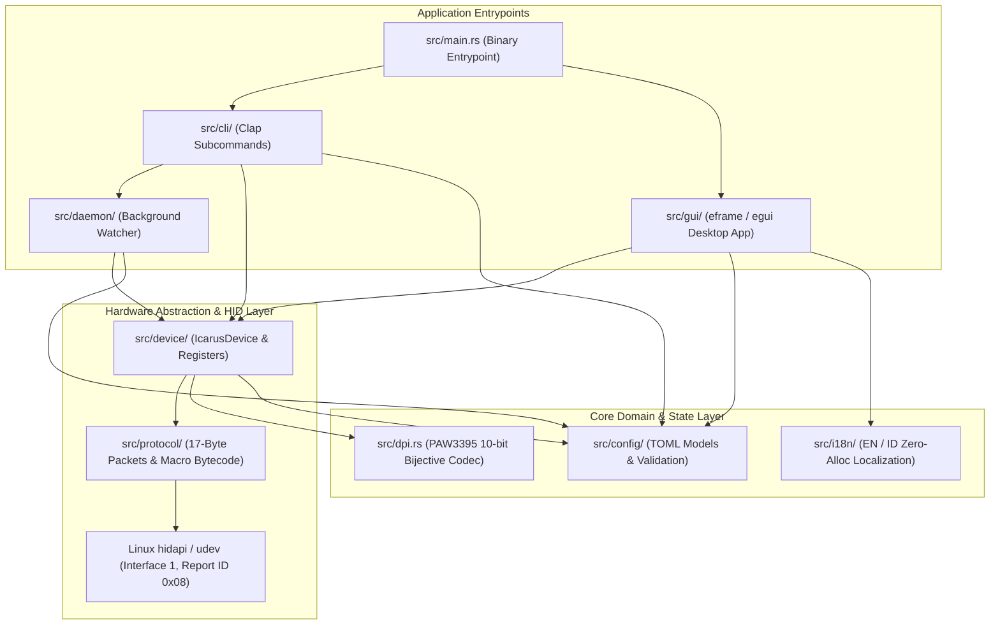
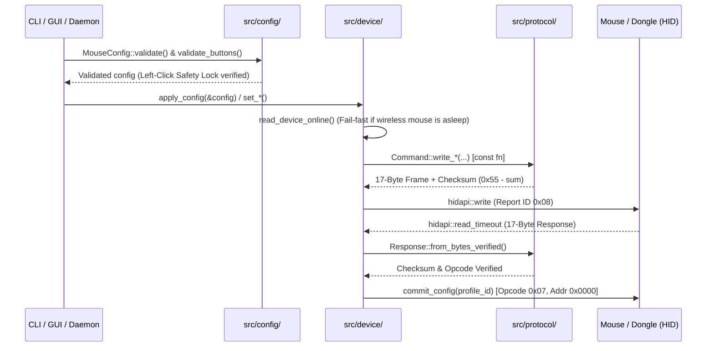

# Architecture & Codebase Structure (`icarus-v2mini`)

This document provides a comprehensive technical overview of the software architecture, modular directory layout, data flows, and engineering patterns implemented in the **ICARUS V2 MINI Linux Driver & Native GUI**.

---

## 1. High-Level Architectural Overview

The project is built using **Rust 2024 Edition** following a **Modular Domain-Driven Design (DDD)** architecture and a strict **Zero Unsafe Code (`unsafe_code = "forbid"`)** policy. Hardware transport, binary protocol framing, configuration domain models, CLI command routing, background daemon integration, localization, and the immediate-mode desktop GUI are decoupled into focused modules with clear boundaries.



---

## 2. Complete Directory & Module Structure

```text
icarus-v2mini-linux/
├── Cargo.toml                     # Package manifest, LTO release profile, and strict lints
├── 99-icarus-mouse.rules          # Linux udev rules for non-root USB HID access
├── icarus-v2mini.desktop          # Freedesktop desktop application launcher entry
├── README.md                      # Main project overview, installation, and CLI/GUI guide
├── CHANGELOG.md                   # Release history and versioned change log
├── CONTRIBUTING.md                # Coding standards, contribution workflow, and roadmap
├── docs/
│   ├── ARCHITECTURE.md            # Deep-dive into modular architecture & data flows (this file)
│   └── PROTOCOL.md                # 17-byte USB HID protocol & EEPROM memory specification
├── examples/
│   ├── README.md                  # Guide to sample profiles and hardware diagnostic utilities
│   ├── dpi_probe.rs               # Low-level hardware DPI register diagnostic utility
│   └── profile-default.toml       # Sample complete TOML configuration profile
├── src/
│   ├── lib.rs                     # Library crate root & public API re-exports
│   ├── main.rs                    # Binary entrypoint: CLI subcommand routing or GUI startup
│   ├── dpi.rs                     # PixArt PAW3395 lookup tables & bijective 10-bit X/Y codec (const fn)
│   ├── protocol/                  # Pure Binary HID Protocol Layer (No I/O)
│   │   ├── mod.rs                 # Report ID (0x08), packet size (17 bytes), & OEM opcodes
│   │   ├── addr.rs                # EEPROM register address constants (0x0000..0x0300+)
│   │   ├── command.rs             # 38 Command packet constructors (const fn) & checksum logic
│   │   ├── response.rs            # 17-byte Response parser + checksum & opcode verification
│   │   ├── macro_codec.rs         # On-board EEPROM macro encoder/decoder & HID key mapping
│   │   └── error.rs               # Structured domain error types (ProtocolError via thiserror)
│   ├── config/                    # Configuration Domain Model & Validation Layer
│   │   ├── mod.rs                 # Public configuration model re-exports
│   │   ├── mouse.rs               # MouseConfig aggregate root, TOML serde, & validate()
│   │   ├── dpi.rs                 # DpiStage model (independent X/Y, RGB color, enabled state)
│   │   ├── sensor.rs              # PollingRate (125..1000Hz) & LiftOffDistance (1mm/2mm) enums
│   │   ├── lighting.rs            # Color, LedMode, DpiLed, and DongleRgbConfig models
│   │   ├── buttons.rs             # ButtonAction enum (Mouse, Keyboard, Media, Macro, FireKey)
│   │   ├── macros.rs              # MacroItem, MacroEvent, MacroEventType, MacroRepeatMode
│   │   └── rules.rs               # AutoProfileRule model for per-application profile switching
│   ├── device/                    # Hardware Driver & Transport Layer (hidapi)
│   │   ├── mod.rs                 # VID/PID constants, ConnectionType, BatteryStatus, IcarusDevice
│   │   ├── discovery.rs           # USB/Wireless interface enumeration & connection opening
│   │   ├── connection.rs          # Low-level HID send/query transport, verification & buffer drain
│   │   ├── registers.rs           # Sensor, DPI, LED, 4K dongle, button, and sleep register I/O
│   │   ├── macros.rs              # 384-byte chunked EEPROM macro slot flashing (0x0300 base)
│   │   ├── firmware.rs            # ISP bootloader firmware update engine (.bin / .hex)
│   │   └── composite.rs           # Full apply_config() and fail-fast read_config() orchestration
│   ├── daemon/                    # Background Service & Linux Desktop Integration Layer
│   │   ├── mod.rs                 # Daemon module exports
│   │   ├── config.rs              # DaemonConfig builder (const fn)
│   │   ├── service.rs             # Main daemon event loop, Ctrl+C handling, & auto-reconnect
│   │   ├── scanner.rs             # Active window detection (Hyprland/Sway/X11/proc) & AutoProfileCache
│   │   ├── notification.rs        # Low-battery & 100%-full desktop notifications via notify-send
│   │   ├── export.rs              # Atomic Waybar/Polybar JSON battery export & config paths
│   │   └── systemd.rs             # Systemd user service unit generator & installer
│   ├── i18n/                      # Bilingual Localization Engine (English & Indonesian)
│   │   ├── mod.rs                 # AppLanguage enum & metadata methods (const fn)
│   │   ├── navigation.rs          # Header, tab labels, and global action button strings
│   │   ├── status.rs              # Connection status, warnings, and toast notification strings
│   │   ├── buttons.rs             # Tab 1 (Buttons & Debounce Tester) translations
│   │   ├── sensor.rs              # Tab 2 (DPI Stages & PAW3395 Sensor) translations
│   │   ├── lighting.rs            # Tab 3 (RGB Lighting & 4K Dongle) translations
│   │   ├── macros.rs              # Tab 4 (Macro Recorder & Timeline Sequencer) translations
│   │   └── settings.rs            # Tab 5 (Settings, 2.4G Pairing, & Auto-Profile) translations
│   ├── cli/                       # Command-Line Interface Layer (Clap)
│   │   ├── mod.rs                 # CLI entrypoint dispatcher (run_cli)
│   │   ├── args.rs                # Clap derive structs & subcommands definition
│   │   ├── helpers.rs             # UTF-8 safe hex color parser & CLI formatting utilities
│   │   └── commands/              # Modular CLI subcommand handlers
│   │       ├── mod.rs             # Command handler exports
│   │       ├── info.rs            # list, info, and battery handlers
│   │       ├── sensor.rs          # rate, lod, angle-snap, motion-sync, ripple, debounce, sleep
│   │       ├── dpi.rs             # dpi (query, active, set X/Y) handlers
│   │       ├── lighting.rs        # led and dongle-rgb handlers
│   │       ├── macros.rs          # macro (flash, flash-all) handlers
│   │       ├── config.rs          # save, apply, and reset profile handlers
│   │       └── system.rs          # pair, long-range, flash firmware, and udev-rule handlers
│   └── gui/                       # Immediate-Mode Desktop GUI Layer (egui / eframe)
│       ├── mod.rs                 # Native window initialization, icon loader, & GUI startup
│       ├── theme.rs               # Custom light/cyberpunk visual theme & typography styling
│       ├── state.rs               # IcarusApp state machine, 120ms HID throttling, & profile sync
│       ├── app.rs                 # eframe::App update loop, global shortcuts, & hot-plug polling
│       ├── widgets.rs             # Custom 3D mouse visualizer, ColorBoard, & reusable widgets
│       └── tabs/                  # Individual tab UI implementations
│           ├── mod.rs             # Tab rendering exports
│           ├── buttons.rs         # Tab 1: Button Remapping & Debounce Click Tester
│           ├── sensor.rs          # Tab 2: DPI Stages, Spectrum Bar, & PAW3395 Calibration
│           ├── lighting.rs        # Tab 3: Mouse RGB Effects, ColorBoard, & 4K Dongle Control
│           ├── macros.rs          # Tab 4: Live Macro Recorder & Timeline Event Editor
│           └── settings.rs        # Tab 5: Language, 2.4G Pairing, Auto-Profile, & ISP Flasher
└── tests/                         # Automated Verification Suite (51 Unit & Integration Tests)
    ├── test_protocol.rs           # 17-byte packet framing, checksums, opcodes, & macro codec
    ├── test_dpi.rs                # PAW3395 lookup table accuracy & 10-bit X/Y roundtrips
    ├── test_config.rs             # TOML serialization, validation clamping, & Safety Lock
    ├── test_daemon.rs             # Waybar JSON schema, mtime cache, & battery notification state
    └── test_i18n.rs               # Bilingual translation completeness & non-empty verification
```

---

## 3. Data Flow & Runtime Execution Paths

### A. Hardware Command & Verification Pipeline
Every hardware configuration write (whether triggered from the CLI, GUI, or Daemon) passes through strict domain validation before being serialized into 17-byte HID packets and transmitted over **Interface 1 (Report ID `0x08`)**:



### B. Real-Time GUI Slider Throttling (`120ms` Interval)
Dragging brightness, speed, or RGB color sliders in an immediate-mode GUI runs at 60+ FPS. Sending raw USB HID packets on every frame would saturate the 2.4GHz wireless transceiver queue:
1. When a slider changes, the UI sets `pending_lighting_sync = true` via `queue_lighting_sync()` (or `queue_dongle_sync()`).
2. Inside `IcarusApp::update()`, `flush_pending_lighting_sync()` dispatches the hardware write only when at least **`120ms`** (~8 Hz) has elapsed since the previous write, or immediately when the user releases the mouse button (`!pointer_down`).

### C. Low-Overhead Background Daemon & Auto-Profile Engine
The background daemon (`icarus-v2mini daemon`) is engineered for near-zero idle CPU and memory footprint:
1. **`mtime`-Backed Configuration Cache (`AutoProfileCache`)**: `~/.config/icarus-v2mini/config.toml` is only re-read and parsed when its filesystem modification timestamp (`mtime`) changes.
2. **Environment-Guarded Window Inspection**:
   - Invokes `hyprctl` only when `$HYPRLAND_INSTANCE_SIGNATURE` is present.
   - Invokes `swaymsg` only when `$SWAYSOCK` is present (traversing both tiled `nodes` and `floating_nodes` recursively).
   - Invokes `xprop` only when `$DISPLAY` is present.
   - Falls back to scanning `/proc/<pid>/comm` into a **64-byte stack buffer (`[u8; 64]`)** with zero heap allocations per process.

---

## 4. Core Engineering Principles

1. **Memory Safety without Compromise (`unsafe_code = "forbid"`)**:
   No `unsafe` blocks exist anywhere in the workspace. Binary parsing, UTF-8 string truncation, and EEPROM buffer serialization rely exclusively on safe slice patterns, iterators, and checked endianness conversions.
2. **Compile-Time Evaluation (`const fn` & `#[must_use]`)**:
   All pure DPI calculations in `src/dpi.rs` and all 38 packet constructors in `src/protocol/command.rs` are marked `#[must_use] pub const fn`, allowing compile-time evaluation and preventing ignored return values.
3. **Zero-Allocation Hot Paths**:
   - `hid_usage_to_key_name` returns `Cow<'static, str>`, returning borrowed static string slices (`&'static str`) for all standard keyboard and mouse keys.
   - Substring matching in the daemon uses a zero-allocation `contains_ignore_ascii_case` byte-window comparator (`&[u8]`) instead of heap-allocating `.to_lowercase()` strings.
4. **Layered Error Handling (`thiserror` vs `anyhow`)**:
   - Low-level protocol and transport layers return structured `ProtocolError` variants (`#[derive(thiserror::Error)]`) so callers can distinguish between `ProtocolError::Timeout` (sleeping wireless mouse) and `ProtocolError::Hid` (unplugged USB device).
   - Application boundaries (`src/main.rs` and `src/cli/`) use `anyhow::Result` with descriptive `.context(...)` messages.
5. **Atomic File Persistence**:
   Battery telemetry exports (`~/.cache/icarus-v2mini/battery.json`) write to a temporary file (`battery.json.tmp`) before executing an atomic POSIX `std::fs::rename`, guaranteeing that status bars like Waybar never read partially written JSON.
