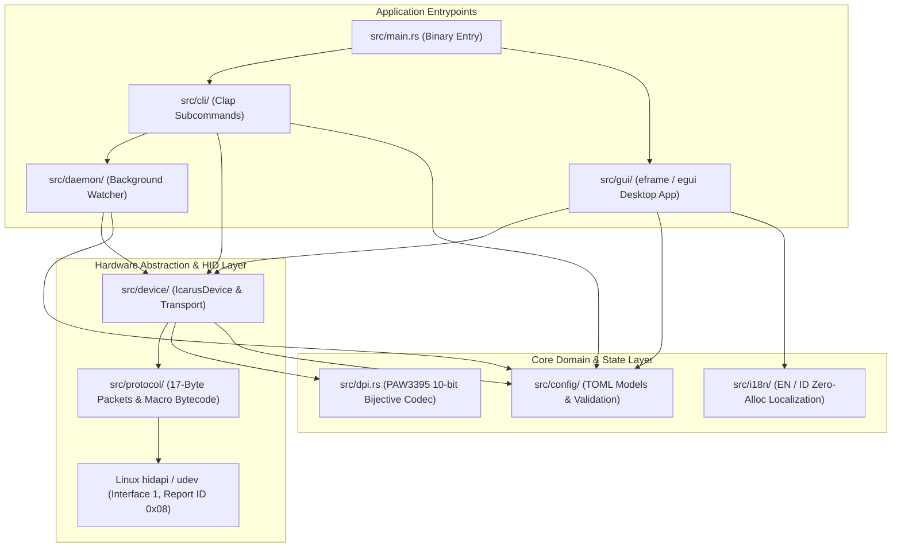
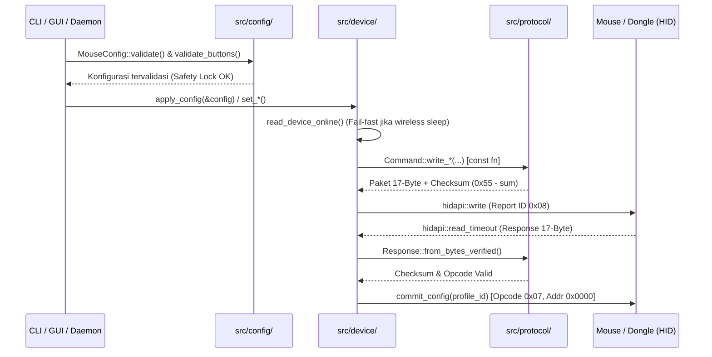

# Architecture & Codebase Structure (`icarus-v2mini`)

Dokumen ini menjelaskan arsitektur perangkat lunak, struktur direktori modular, alur data (*data flow*), serta pola desain (*design patterns*) yang digunakan dalam proyek **ICARUS V2 MINI Linux Driver & Native GUI**.

---

## 1. Gambaran Umum Arsitektur (High-Level Overview)

Proyek ini dibangun menggunakan **Rust 2024 Edition** dengan pendekatan **Modular Domain-Driven Design (DDD)** dan prinsip **Zero Unsafe Code (`unsafe_code = "forbid"`)**. Seluruh komunikasi perangkat keras, logika bisnis konfigurasi, antarmuka CLI, daemon latar belakang, dan aplikasi desktop GUI dipisahkan ke dalam modul-modul dengan batas tanggung jawab (*Separation of Concerns*) yang tegas.



---

## 2. Struktur Direktori Lengkap

```text
icarus-v2mini-linux/
├── Cargo.toml                     # Manifest paket, profil rilis LTO, dan aturan lint ketat
├── 99-icarus-mouse.rules          # Aturan udev Linux untuk akses USB HID tanpa root
├── icarus-v2mini.desktop          # Pintasan peluncur aplikasi desktop Linux (Freedesktop)
├── README.md                      # Dokumentasi utama proyek
├── CHANGELOG.md                   # Catatan rilis dan riwayat perubahan versi
├── CONTRIBUTING.md                # Panduan cara koding, standar kualitas, dan kontribusi
├── docs/
│   ├── ARCHITECTURE.md            # Penjelasan mendalam arsitektur & struktur kode (file ini)
│   └── PROTOCOL.md                # Spesifikasi protokol HID 17-byte & peta memori EEPROM
├── examples/
│   ├── README.md                  # Panduan penggunaan contoh profil & alat diagnostik
│   ├── dpi_probe.rs               # Utilitas diagnostik pembacaan register DPI perangkat keras
│   └── profile-default.toml       # Contoh konfigurasi profil lengkap dalam format TOML
├── src/
│   ├── lib.rs                     # Root crate library & re-export API publik
│   ├── main.rs                    # Entrypoint utama: routing argumen CLI atau peluncuran GUI
│   ├── dpi.rs                     # Kalkulasi & tabel lookup sensor PixArt PAW3395 (const fn)
│   ├── protocol/                  # Layer Protokol Biner HID (Pure / No I/O)
│   │   ├── mod.rs                 # Konstanta Report ID (0x08), ukuran paket (17 byte), & opcode
│   │   ├── addr.rs                # Peta alamat register EEPROM (0x0000..0x0300+)
│   │   ├── command.rs             # 38 builder paket Command (const fn) & algoritma checksum
│   │   ├── response.rs            # Parser Response 17-byte + verifikasi checksum & opcode
│   │   ├── macro_codec.rs         # Encoder/decoder bytecode makro EEPROM & pemetaan HID key
│   │   └── error.rs               # Definisi error domain terstruktur (ProtocolError via thiserror)
│   ├── config/                    # Layer Model Data Konfigurasi & Validasi
│   │   ├── mod.rs                 # Ekspor tipe-tipe konfigurasi
│   │   ├── mouse.rs               # Struct utama MouseConfig, serialisasi TOML, & validate()
│   │   ├── dpi.rs                 # Model DpiStage (X/Y independen, warna RGB, status aktif)
│   │   ├── sensor.rs              # Enum PollingRate (125..1000Hz) & LiftOffDistance (1mm/2mm)
│   │   ├── lighting.rs            # Model Color, LedMode, DpiLed, dan DongleRgbConfig
│   │   ├── buttons.rs             # Enum ButtonAction (Mouse, Keyboard, Media, Macro, FireKey)
│   │   ├── macros.rs              # Model MacroItem, MacroEvent, MacroEventType, MacroRepeatMode
│   │   └── rules.rs               # Model AutoProfileRule untuk perpindahan profil per-aplikasi
│   ├── device/                    # Layer Driver Perangkat Keras (hidapi Transport)
│   │   ├── mod.rs                 # Definisi VID/PID, ConnectionType, BatteryStatus, IcarusDevice
│   │   ├── transport.rs           # Discovery USB/Wireless, send/query HID, & drain buffer
│   │   ├── sensor.rs              # Operasi baca/tulis DPI, Polling Rate, LOD, Debounce, Sleep
│   │   ├── lighting.rs            # Operasi baca/tulis RGB mouse & RGB dongle 4K
│   │   ├── buttons.rs             # Operasi pemetaan 6 tombol fisik, Keyboard, Media, & FireKey
│   │   ├── macros.rs              # Flash slot makro (384 byte/slot) ke EEPROM perangkat keras
│   │   ├── firmware.rs            # Flasher firmware ISP bootloader (.bin / .hex)
│   │   └── composite.rs           # Orkestrasi apply_config() dan read_config() secara utuh
│   ├── daemon/                    # Layer Layanan Latar Belakang (Systemd & Desktop Integration)
│   │   ├── mod.rs                 # Loop utama daemon, penanganan sinyal Ctrl+C, & auto-reconnect
│   │   ├── config.rs              # Builder DaemonConfig (const fn)
│   │   ├── scanner.rs             # Deteksi window aktif (Hyprland/Sway/X11/proc) & AutoProfileCache
│   │   ├── notification.rs        # Notifikasi baterai lemah/penuh via notify-send
│   │   ├── export.rs              # Ekspor JSON baterai atomik (Waybar/Polybar) & path konfigurasi
│   │   └── service.rs             # Generator & installer unit systemd user service
│   ├── i18n/                      # Layer Lokalisasi Dwibahasa (English & Bahasa Indonesia)
│   │   ├── mod.rs                 # Enum AppLanguage & metadata bahasa
│   │   ├── general.rs             # Terjemahan header, tab, status koneksi, & tombol global
│   │   ├── buttons.rs             # Terjemahan tab Tombol, Debounce, & Click Tester
│   │   ├── sensor.rs              # Terjemahan tab Sensor, DPI, & Kalibrasi PAW3395
│   │   ├── lighting.rs            # Terjemahan tab Pencahayaan RGB & Dongle 4K
│   │   ├── macros.rs              # Terjemahan tab Sequencer & Perekam Makro
│   │   └── settings.rs            # Terjemahan tab Pengaturan, Pairing 2.4G, & Auto-Profile
│   └── cli/                       # Layer Antarmuka Baris Perintah (Clap CLI)
│       ├── mod.rs                 # Definisi parser argumen Cli & subcommands
│       ├── helpers.rs             # Parser warna hex UTF-8 safe & utilitas pemformatan
│       └── commands/              # Implementasi handler tiap subcommand CLI
│           ├── info.rs            # Handler list, info, battery, dan udev-rule
│           ├── sensor.rs          # Handler rate, lod, angle-snap, motion-sync, ripple, debounce, sleep
│           ├── dpi.rs             # Handler dpi (query, active, set X/Y)
│           ├── lighting.rs        # Handler led dan dongle-rgb
│           ├── macros.rs          # Handler macro (flash, flash-all)
│           ├── profile.rs         # Handler save, apply, dan reset
│           └── hardware.rs        # Handler pair, long-range, dan flash firmware
│   └── gui/                       # Layer Aplikasi Desktop (egui / eframe)
│       ├── mod.rs                 # Inisialisasi window native, ikon aplikasi, & tema visual
│       ├── state.rs               # State machine IcarusApp, throttling HID, & sinkronisasi profil
│       ├── app.rs                 # Loop render utama eframe::App, shortcut global, & hot-plug poll
│       ├── widgets.rs             # Komponen visual kustom (3D Mouse Visualizer, ColorBoard, dll.)
│       └── tabs/                  # Implementasi UI tiap tab
│           ├── buttons.rs         # UI Tab 1: Pemetaan Tombol & Debounce Click Tester
│           ├── sensor.rs          # UI Tab 2: Stage DPI, Kurva Spektrum, & Tuning PAW3395
│           ├── lighting.rs        # UI Tab 3: Efek RGB Mouse, ColorBoard, & Kontrol Dongle 4K
│           ├── macros.rs          # UI Tab 4: Perekam Makro Live & Timeline Event Editor
│           └── settings.rs        # UI Tab 5: Bahasa, Pairing 2.4G, Auto-Profile, & Firmware ISP
└── tests/                         # Suite Pengujian Otomatis (51 Unit & Integration Tests)
    ├── test_protocol.rs           # Pengujian paket 17-byte, checksum, opcode, & codec makro
    ├── test_dpi.rs                # Pengujian kepresisian tabel PAW3395 & encoding 10-bit X/Y
    ├── test_config.rs             # Pengujian serialisasi TOML, sanitasi, & Safety Lock
    ├── test_daemon.rs             # Pengujian skema JSON Waybar, cache mtime, & state baterai
    └── test_i18n.rs               # Pengujian kelengkapan string dwibahasa (EN/ID)
```

---

## 3. Alur Data & Interaksi Antar-Layer

### A. Alur Eksekusi Perintah Perangkat Keras (HID Command Flow)
Setiap perubahan pengaturan (baik dari CLI maupun GUI) melewati validasi ketat sebelum diubah menjadi frame HID 17-byte dan dikirim ke *endpoint* vendor (Interface 1, Report ID `0x08`):



### B. Alur Throttling Real-Time di GUI (`120ms` Slider Sync)
Agar pergeseran slider kecerahan/warna RGB tidak membanjiri bus USB/2.4GHz (60+ paket/detik pada 60 FPS), `IcarusApp` menerapkan mekanisme *throttling* berbasis waktu:
1. Saat slider digeser, UI memanggil `queue_lighting_sync()` atau `queue_dongle_sync()`.
2. Pada `IcarusApp::update()`, `flush_pending_lighting_sync()` hanya mengirimkan paket HID jika interval minimal **`120ms`** telah berlalu sejak pengiriman terakhir, atau tepat ketika tombol mouse dilepas (`!pointer_down`).

### C. Alur Deteksi Aplikasi & Auto-Profile pada Daemon
Daemon latar belakang (`icarus-v2mini daemon`) dirancang agar sangat hemat CPU dan memori:
1. **Caching Konfigurasi Berbasis `mtime` (`AutoProfileCache`)**: File `~/.config/icarus-v2mini/config.toml` hanya dibaca ulang dari disk jika *modification timestamp* (`mtime`) berubah.
2. **Deteksi Kompositor Berpenjaga Environment**:
   - Hanya menjalankan `hyprctl` jika `$HYPRLAND_INSTANCE_SIGNATURE` terdefinisi.
   - Hanya menjalankan `swaymsg` jika `$SWAYSOCK` terdefinisi (mendukung `nodes` dan `floating_nodes` secara rekursif).
   - Hanya menjalankan `xprop` jika `$DISPLAY` terdefinisi.
   - *Fallback* ke pemindaian `/proc/<pid>/comm` menggunakan buffer stack `[u8; 64]` tanpa alokasi heap (`String`) per proses.

---

## 4. Prinsip Rekayasa & Kualitas Kode (Engineering Principles)

1. **Keamanan Memori Mutlak (`unsafe_code = "forbid"`)**:
   Tidak ada satu baris pun blok `unsafe` di dalam repositori ini. Seluruh manipulasi byte menggunakan *slice pattern matching*, iterator, dan fungsi konversi endianness bawaan pustaka standar (`u16::from_le_bytes`, `to_be_bytes`).
2. **Evaluasi Waktu Kompilasi (`const fn` & `#[must_use]`)**:
   Seluruh fungsi kalkulasi DPI di `src/dpi.rs` dan seluruh 38 konstruktor paket di `src/protocol/command.rs` dideklarasikan sebagai `#[must_use] pub const fn`, memungkinkan kompilator Rust mengevaluasi konstanta protokol pada saat kompilasi tanpa biaya runtime.
3. **Bebas Alokasi yang Tidak Perlu (Zero-Allocation Hot Paths)**:
   - Pemetaan kode HID ke nama tombol (`hid_usage_to_key_name`) mengembalikan `Cow<'static, str>` sehingga 99% tombol standar mengembalikan referensi string statis (`&'static str`) tanpa alokasi heap.
   - Pencocokan pola aplikasi di daemon menggunakan `contains_ignore_ascii_case` berbasis *byte slice windows* (`&[u8]`), bukan `.to_lowercase()` yang mengalokasikan `String` baru.
4. **Penanganan Error Berlapis (`thiserror` vs `anyhow`)**:
   - Layer protokol dan driver menggunakan enum error terstruktur `ProtocolError` (`#[derive(thiserror::Error)]`) sehingga pemanggil dapat melakukan *pattern matching* spesifik (misalnya membedakan `ProtocolError::Timeout` saat mouse *sleep* vs `ProtocolError::Hid` saat dongle dicabut).
   - Layer aplikasi terluar (`src/main.rs` dan `src/cli/`) menggunakan `anyhow::Result` dengan `.context(...)` yang informatif bagi pengguna akhir.
5. **Penulisan File Atomik (Atomic File Persistence)**:
   Ekspor telemetri baterai (`~/.cache/icarus-v2mini/battery.json`) ditulis ke file sementara (`battery.json.tmp`) terlebih dahulu lalu diganti secara atomik menggunakan `std::fs::rename`, mencegah Waybar/Polybar membaca file JSON yang terpotong (*partial write*).
